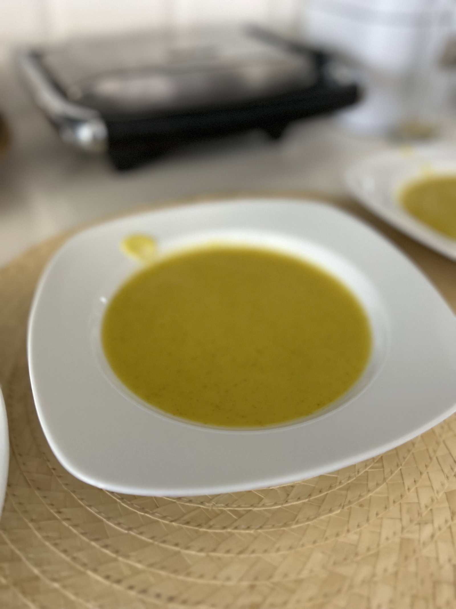

# Sopa SF

Bota lá para dentro e está feito!!

## Recipe

| Field | Value |
| --- | --- |
| languageLocale | pt-PT |
| deviceTypeIds | 13 |
| servings | 10 (doses) |
| recipeId | [https://www.monsieur-cuisine.com/pt-pt/previsao-da-receita?recipe-id=10441151](https://www.monsieur-cuisine.com/pt-pt/previsao-da-receita?recipe-id=10441151) |
| ingredientGroupName | Ingredientes gerais |
| preparationTime | 10 |
| readyInTime | 40 |
| categoryIds | 231, 578, 587 |
| complexityId | 203 |

## Ingredients

- 1 cenoura grande (120 g) <!-- mc-ingredient: {"amount":"120","unit":"g","isOptional":false} -->
- 1 cebola grande (150 g) <!-- mc-ingredient: {"amount":"190","unit":"g","isOptional":false} -->
- 3 batatas farinhentas (300 g) <!-- mc-ingredient: {"amount":"300","unit":"g","isOptional":false} -->
- abóbora <!-- mc-ingredient: {"amount":"175","unit":"g","isOptional":false} -->
- alho francês <!-- mc-ingredient: {"amount":"90","unit":"g","isOptional":false} -->
- curgete <!-- mc-ingredient: {"amount":"220","unit":"g","isOptional":false} -->
- algo verde <!-- mc-ingredient: {"amount":"200","unit":"g","isOptional":false} -->

## Steps

1. **Preparar tudo**: Descascar tudo o que tem casca e cortar em bocados.
2. **Enfiar tudo no copo**: Enfiar tudo no copo <!-- mc-mode: {"type":"scale","modules":null,"modeSetting":null,"deviceSettings":[{"order":0,"weight":1295}]} -->
3. **Adicionar água**: 1.2L de água <!-- mc-mode: {"type":"scale","modules":null,"modeSetting":null,"deviceSettings":[{"order":0,"weight":1200}]} -->
4. **Cozer**: <!-- mc-mode: {"type":"customized","modules":null,"modeSetting":null,"deviceSettings":[{"time":2100,"order":0,"speed":1,"clockwise":true,"temperature":100}]} -->
5. **Adicionar azeite**: Levantar tampa e adicionar 20g de azeite <!-- mc-mode: {"type":"scale","modules":null,"modeSetting":null,"deviceSettings":[{"order":0,"weight":20}]} -->
6. **Passar**: <!-- mc-mode: {"type":"puree","modules":null,"modeSetting":null,"deviceSettings":[{"time":120,"order":0}]} -->
