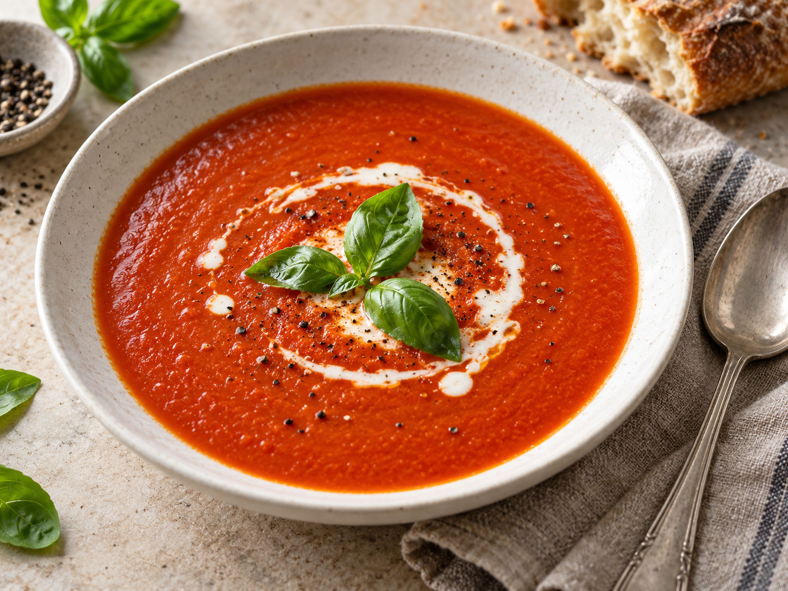

# Sopa cremosa de tomate

Uma sopa simples de tomate e manjericão, ideal para um almoço leve.

## Recipe

| Field | Value |
| --- | --- |
| Idioma | pt-PT |
| Tipo de aparelho | Monsieur Cuisine smart |
| Doses | 4 (porções) |
| Grupo de ingredientes | Ingredientes |
| Dificuldade | fácil |
| Tempo de preparação | 10 |
| Tempo total | 35 |
| Categorias | Sopas & guisados |

## Ingredients

- Tomates maduros <!-- mc-ingredient: {"amount":"800","unit":"g","isOptional":false} -->
- Cebola, cortada em quartos <!-- mc-ingredient: {"amount":"1","unit":"","isOptional":false} -->
- Dentes de alho <!-- mc-ingredient: {"amount":"2","unit":"","isOptional":false} -->
- Azeite <!-- mc-ingredient: {"amount":"1","unit":"c. de sopa","isOptional":false} -->
- Caldo de legumes <!-- mc-ingredient: {"amount":"500","unit":"","isOptional":false} -->
- Folhas de manjericão fresco <!-- mc-ingredient: {"amount":"8","unit":"","isOptional":false} -->
- Sal e pimenta q.b.

## Steps

1. Coloque a cebola e o alho no copo e pique durante 5 segundos na velocidade 5.
2. Junte o azeite e cozinhe durante 3 minutos a 120 °C, na velocidade 1.
3. Adicione os tomates, o caldo, o sal e a pimenta. Cozinhe durante 25 minutos a 100 °C, na velocidade 2.
4. Junte o manjericão e triture durante 1 minuto, aumentando gradualmente até à velocidade 8.
