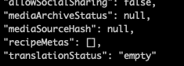
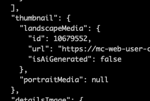

# teste

## Recipe

| Field | Value |
| --- | --- |
| languageLocale | pt-PT |
| deviceTypeIds | 13 |
| servings | 2 (frasco) |
| recipeId | 10440324 |
| ingredientGroupName | Ingredientes gerais |
| preparationTime | 1 |
| readyInTime | 1 |
| categoryIds | 271 |
| complexityId | 203 |
| detailsImage | images/10440324-details.png |

## Nutrition

| Nutrient | Amount | Unit |
| --- | --- | --- |
| calories | 100 | kCal |

## Ingredients

- aassdf <!-- mc-ingredient: {"amount":"122","unit":"","isOptional":false} -->

## Steps

1. **reqewe**: nada DE MAIS
2. **teste programa**: Cozinhar lentamente a 50 °C durante 15 minutos. <!-- mc-mode: {"type":"slow_cooking","modules":null,"modeSetting":null,"deviceSettings":[{"time":900,"order":0,"temperature":50}]} -->

## Details image

